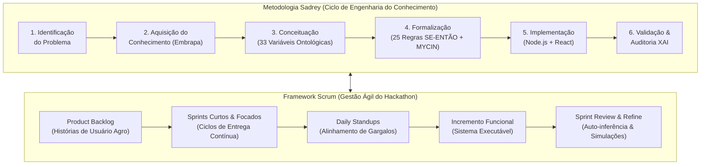
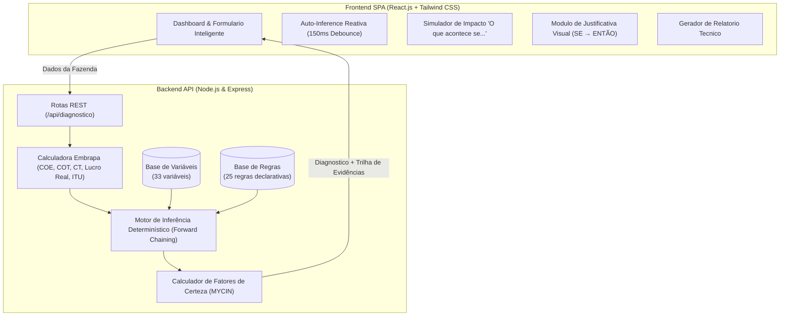

# 🐮 MicroLeiteMacroNegocios — Apresentação Técnica e Executiva do Projeto

> **Hackathon UFJF 2026 (56h)** — XXVIII Semana da Computação DCC/UFJF & RERUM  
> **Tema 3:** Economia, Zootecnia e Qualidade do Leite  
> **Metodologias:** Engenharia do Conhecimento (Metodologia Sadrey) + Gestão Ágil de Software (Framework Scrum)  
> **Modelo de IA Utilizado:** Google Gemini 2.5 Pro (Antigravity Agentic AI / DeepMind) para Pair Programming e Engenharia de Conhecimento  
> **Autores:** Equipe MicroLeiteMacroNegocios  

---

## 📑 Índice da Apresentação
1. [Visão Geral & O Problema da Pecuária Leiteira](#1-visão-geral--o-problema-da-pecuária-leiteira)
2. [Metodologias: Sadrey (Conhecimento) & Scrum (Agilidade)](#2-metodologias-sadrey-conhecimento--scrum-agilidade)
3. [Coleta de Requisitos e Fontes de Especialistas](#3-coleta-de-requisitos-e-fontes-de-especialistas)
4. [Arquitetura do Sistema e Motor Especialista](#4-arquitetura-do-sistema-e-motor-especialista)
5. [Modelagem Matemática e Zootécnica](#5-modelagem-matemática-e-zootécnica)
6. [Funcionalidades do Produto](#6-funcionalidades-do-produto)
7. [Diferenciais Competitivos e Demonstração de Casos](#7-diferenciais-competitivos-e-demonstração-de-casos)
8. [Conclusão e Próximos Passos](#8-conclusão-e-próximos-passos)

---

## 1. Visão Geral & O Problema da Pecuária Leiteira

### 🎯 O Desafio
A pecuária leiteira no Brasil enfrenta margens econômicas estreitas e alta vulnerabilidade a variáveis multifatoriais:
- **Ambiência e Clima:** O estresse térmico por calor (elevado ITU) reduz a ingestão de matéria seca e derruba a produção em até 30%.
- **Nutrição e Fisiologia:** Desbalanços na relação volumoso:concentrado geram acidose ruminal subaguda (SARA) e desperdício de nitrogênio.
- **Saúde e Sanidade:** Mastites subclínicas e problemas de casco (claudicação) provocam descartes precoces e penalizações severas no preço do leite (CCS/CBT).
- **Gestão Financeira Desconectada:** O produtor frequentemente confunde fluxo de caixa momentâneo com lucro real sustentável, sofrendo **descapitalização silenciosa** ao ignorar a depreciação e o custo de oportunidade da terra.

### 💡 A Solução: MicroLeiteMacroNegocios
Um **Sistema Especialista Determinístico com Fatores de Certeza (MYCIN/Shortliffe)** que integra dados zootécnicos, climáticos, sanitários e econômicos para fornecer **diagnósticos em tempo real**, **explicações transparentes (auditáveis)** e **planos de ação imediatos priorizados**.

```
   ┌────────────────────────────────────────────────────────┐
   │                 MicroLeiteMacroNegocios                │
   │                                                        │
   │  [Zootecnia] + [Clima/ITU] + [Saúde] + [Custos Embrapa]│
   │                           ▼                            │
   │        Motor de Inferência Baseado em Regras           │
   │             (Forward Chaining + MYCIN CF)              │
   │                           ▼                            │
   │  Diagnóstico Preciso + Trilha de Auditoria Explicativa │
   │              + Plano de Ação Imediato                  │
   └────────────────────────────────────────────────────────┘
```

---

## 2. Metodologias: Sadrey (Conhecimento) & Scrum (Agilidade)

O projeto combinou de forma sinérgica o rigor da **Engenharia de Conhecimento (Metodologia Sadrey)** com a velocidade e adaptação do **Framework Scrum**:



### 1. Metodologia Sadrey (Especialista):
- **Identificação:** Mapeamento das causas reais de prejuízo nas propriedades brasileiras.
- **Aquisição:** Elicitação formal junto a Embrapa Gado de Leite, NRC e CEPEA/USP.
- **Conceituação:** Catálogo ontológico de 33 variáveis em 6 categorias.
- **Formalização:** 25 regras declarativas com Fatores de Certeza combinatórios.
- **Implementação:** Motor *Forward Chaining* desacoplado e auditável.
- **Validação:** Calibração com 5 cenários reais de fazendas.

### 2. Framework Scrum (Agilidade):
- **Product Backlog:** Priorização baseada no impacto econômico imediato para o produtor.
- **Sprints de Execução:** Sprints rápidos dividindo escopos de regras, motor de inferência, frontend reativo e módulo de explicação.
- **Daily Standups:** Reuniões de alinhamento rápido para resolução de bloqueios e dependências.
- **Incremento Potencialmente Entregável (Definition of Done):** Cada funcionalidade foi testada, validada e documentada com build e commit rastreável.

---

## 3. Coleta de Requisitos e Fontes de Especialistas

### 📚 Bases Técnicas Utilizadas

| Domínio | Fonte Especialista | Parâmetros & Modelos Elicitados |
| :--- | :--- | :--- |
| **Economia Leiteira** | **Embrapa Gado de Leite (Custopec)** | Metodologia de Custo Operacional Efetivo (COE), Custo Operacional Total (COT) e Custo Total (CT) com remuneração do capital. |
| **Bioclimatologia Animal** | **Thom (1959) & NRC Bovine Standards** | Fórmula do Índice de Temperatura e Umidade (ITU): $ITU = 0.8T + \frac{UR}{100}(T - 14.4) + 46.4$. Limite de conforto ($ITU < 72$). |
| **Nutrição & Fisiologia Ruminal** | **NRC & Zootecnia de Precisão** | Balanço volumoso:concentrado ($< 50\%$ = risco de SARA/acidose), Nitrogênio Ureico no Leite (NUL ideal: 10-14 mg/dL), Escore de Condição Corporal (ECC ideal: 2.75 - 3.25). |
| **Sanidade & Qualidade** | **Instruções Normativas MAPA 76/77** | Contagem de Células Somáticas (CCS), Contagem Bacteriana Total (CBT) e incidência de mastite clínica/subclínica. |
| **Mercado e Cotações** | **CEPEA / ESALQ-USP & Scot Consultoria** | Séries históricas de preço do leite ao produtor (R$/L) e bonificações por sólidos e sanidade. |

---

## 4. Arquitetura do Sistema e Motor Especialista

A arquitetura do MicroLeiteMacroNegocios é desacoplada, moderna e totalmente auditável:



### 🧠 Funcionamento do Motor de Inferência (Forward Chaining)
1. **Passo 1 (Pré-processamento):** Os dados brutos do usuário são validados e complementados pelos cálculos matemáticos (ITU, proporção de lactação, produtividade por trabalhador, COE, COT, CT).
2. **Passo 2 (Avaliação de Premissas):** O motor varre a base de regras `rules.json`. Cada regra com operadores lógicos compostos (`AND`, `OR`, `<`, `>`, `<=`, `>=`, `==`) é avaliada contra os fatos da fazenda.
3. **Passo 3 (Cálculo de Certeza MYCIN):** O Fator de Certeza da regra é ajustado com base na intensidade do desvio das premissas:
   $$CF_{combinado} = CF_{regra} \times \min(CF_{premissas})$$
4. **Passo 4 (Geração de Trilha de Explicação):** O sistema registra o porquê de cada regra ter disparado, listando as premissas satisfeitas, a severidade e a recomendação técnica imediata.

---

## 5. Modelagem Matemática e Zootécnica

### 📐 Equações Centrais Implementadas

1. **Índice de Temperatura e Umidade (ITU):**
   $$ITU = 0.8 \times T_{amb} + \frac{UR}{100} \times (T_{amb} - 14.4) + 46.4$$
   * Classificação: $ITU \le 72$ (Conforto) | $72 < ITU \le 78$ (Estresse Leve/Moderado) | $ITU > 78$ (Estresse Severo/Crítico).

2. **Custo Operacional Efetivo (COE):**
   $$COE = \text{Alimentação} + \text{Mão de Obra} + \text{Sanidade} + \text{Energia/Combustível} + \text{Manutenção}$$

3. **Custo Operacional Total (COT) e Custo Total (CT):**
   $$COT = COE + \text{Depreciação de Máquinas e Benfeitorias} + \text{Mão de Obra Familiar}$$
   $$CT = COT + \text{Remuneração do Capital Próprio e Terra (Custo de Oportunidade)}$$

4. **Margens e Lucro Real Econômico:**
   - **Margem Bruta:** $\text{Receita Total} - COE$
   - **Margem Líquida:** $\text{Receita Total} - COT$
   - **Lucro Real Econômico:** $\text{Receita Total} - CT$

---

## 6. Funcionalidades do Produto

### 🌟 Destaques da Plataforma:

1. **Inferência em Tempo Real (Zero Latência):**
   - Conforme o usuário ajusta qualquer parâmetro da fazenda, o motor especialista reavalia instantaneamente todas as 25 regras sem necessidade de recarregar a tela.
2. **Barra de Presets de Cenários Reais:**
   - Permite carregar 5 arquétipos brasileiros com um clique:
     - 🏆 *Fazenda Modelo Alta Produção*
     - ☀️ *Estresse Térmico & Acidose Ruminal*
     - 🚨 *Crise Sanitária & Mastite Subclínica*
     - 💸 *Descapitalização Silenciosa*
     - 🌿 *Produtor Familiar a Pasto*
3. **Simulador de Impacto ("O que acontece se..."):**
   - Botões interativos que aplicam correções imediatas (ex: *Resfriar ambiente com ITU < 72*, *Alcançar bonificação CCS < 200k*, *Ajustar relação de volumoso para 60%*) mostrando o ganho financeiro na hora.
4. **Plano de Ação Imediato Priorizado:**
   - Box que classifica e elenca os 3 problemas mais críticos da fazenda com as respectivas recomendações zootécnicas e sanitárias.
5. **Módulo de Explicação Transparente (Explainable AI - XAI):**
   - Abertura de cada regra disparada com visualização da lógica formal `SE ... ENTÃO ...`, justificando o diagnóstico técnico de forma 100% auditável.
6. **Gráficos Dinâmicos com Recharts:**
   - Decomposição visual de custos (COE vs COT vs CT), sensibilidade de lucratividade por variação de preço do leite e comparativo com médias de mercado CEPEA.
7. **Emissão de Laudo Técnico Pericial:**
   - Modal com exportação formatada para impressão/PDF do diagnóstico da fazenda, com parecer zootécnico, indicadores e recomendações.

---

## 7. Diferenciais Competitivos e Demonstração de Casos

### 📊 Comparativo de Mercado

| Recurso | Planilhas Tradicionais | Softwares de Gestão Agro | MicroLeiteMacroNegocios (Nosso Sistema) |
| :--- | :---: | :---: | :---: |
| **Diagnóstico Automatizado** | ❌ Não | ❌ Apenas relatórios | ✅ **Sim (25 regras especialistas)** |
| **Trilha Explicativa (XAI)** | ❌ Não | ❌ Não | ✅ **Sim (SE → ENTÃO auditável)** |
| **Grau de Certeza (MYCIN)** | ❌ Não | ❌ Não | ✅ **Sim (Fatores de Certeza -1 a +1)** |
| **Cálculo Bioclimático (ITU)** | ❌ Não | ❌ Raro | ✅ **Sim (Integrado a perdas de leite)** |
| **Alerta de Descapitalização** | ❌ Não | ⚠️ Parcial | ✅ **Sim (Separa COE, COT e CT)** |
| **Simulação em Tempo Real** | ❌ Não | ❌ Não | ✅ **Sim (Debounce 150ms)** |

---

## 8. Conclusão e Próximos Passos

### 🏆 Impacto do MicroLeiteMacroNegocios
- **Democratização do Acesso à Consultoria:** Leva a expertise de zootecnistas e agrônomos seniores para médios e pequenos produtores de leite.
- **Prevenção de Falência:** Detecta a descapitalização oculta antes que o produtor precise vender matrizes para cobrir custos operacionais.
- **Bem-Estar Animal e Sanidade:** Reduz o estresse calórico e o descarte precoce por mastite e claudicação.

### 🔮 Roadmap Futuro
1. **Integração com Sensores IoT:** Leitura automatizada de temperatura, umidade do galpão (Free-Stall/Compost Barn) e medidores de fluxo de leite.
2. **Integração com Coleiras de Monitoramento:** Ingestão de dados de ruminação e detecção de cios para automação de índices reprodutivos.
3. **App Mobile Offline:** Funcionamento no campo em áreas sem conectividade à internet.

---

> **MicroLeiteMacroNegocios** — *Inteligência Especialista para a Sustentabilidade do Agronegócio Brasileiro.*
