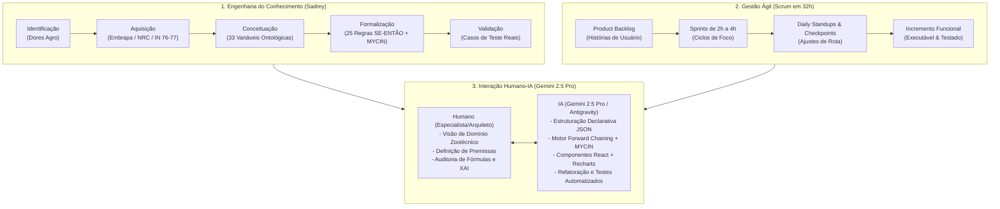

# 📄 Documento Técnico: Especificação Formal do Problema, Modelagem e Arquitetura da Solução

> **Projeto:** MicroLeiteMacroNegocios  
> **Evento:** XXVIII Semana da Computação DCC/UFJF & RERUM (Hackathon UFJF 2026 — Maratona de 32 Horas) — **Tema 3: Economia, Zootecnia e Qualidade do Leite**  
> **Classificação:** Sistema Especialista Baseado em Regras com Incerteza (MYCIN/Shortliffe) e Raciocínio Baseado em Fatos  
> **Modelo de IA & Ferramentas:** Google Gemini 2.5 Pro (Antigravity Agentic AI) para Elicitação de Conhecimento, Arquitetura e Pair Programming  
> **Autores:** Equipe MicroLeiteMacroNegocios  

---

## 1. Formulação do Problema no Agronegócio

A atividade leiteira no Brasil é caracterizada por margens econômicas estreitas e alta vulnerabilidade a distúrbios multifatoriais de ambiência, manejo nutricional e sanidade. A tomada de decisão dos produtores costuma falhar devido a quatro gargalos críticos:

### 1.1. Ocultação Contábil e Descapitalização Silenciosa
Muitos gestores rurais utilizam apenas o regime de caixa simplificado, comparando a receita bruta da venda de leite com as despesas imediatas de desembolso (Custo Operacional Efetivo - COE). Com isso:
- Ignora-se a depreciação de maquinários, tratores, benfeitorias e ordenhadeiras (Custo Operacional Total - COT).
- Desconsidera-se a remuneração de oportunidade do capital próprio e da terra (Custo Total - CT).
- **Consequência:** A propriedade aparenta ter lucro no curto prazo, mas consome seu próprio patrimônio, sendo forçada a vender matrizes para cobrir custos de reposição no médio/longo prazo.

### 1.2. Estresse Térmico por Calor (Bioclimatologia Animal)
O gado leiteiro de alta produção (especialmente raças *Bos taurus* e cruzamentos *Girolando*) sofre redução de apetite e queda de ruminação quando submetido a calor e umidade elevados:
- O **Índice de Temperatura e Umidade (ITU)** acima de 72 pontos desencadeia mecanismos termorregulatórios dissipativos (taquipneia, salivação excessiva).
- Ocorre queda na produção diária de até 3,5 L/vaca/dia, redução do teor de sólidos e aumento de custos com resfriamento emergencial inadequado.

### 1.3. Desordens Metabólico-Nutricionais (Acidose Ruminal SARA)
Para compensar quedas na produção, produtores frequentemente elevam a proporção de concentrado na dieta acima de 50%. A fermentação rápida de carboidratos solúveis no rúmen resulta em:
- Queda drástica do pH ruminal ($pH < 5.8$), caracterizando a **Acidose Ruminal Subaguda (SARA)**.
- Desperdício de nitrogênio na corrente sanguínea, mensurado pelo aumento do **Nitrogênio Ureico no Leite (NUL > 16 mg/dL)**.
- Claudicação, laminite e descarte involuntário de animais no pico de lactação.

### 1.4. Penalizações Higiênico-Sanitárias (MAPA IN 76/77)
Contagens elevadas de **Células Somáticas (CCS > 400.000 cél/mL)** e **Bacteriana Total (CBT > 100.000 UFC/mL)** indicam mastite e deficiências de refrigeração, resultando em:
- Perda volumétrica oculta de síntese láctea nos alvéolos mamários.
- Descontos severos de até R$ 0,25/litro aplicados pelas indústrias de laticínios.

---

## 2. Modelagem Matemática e Formal do Domínio

O sistema integra modelos quantitativos validados da **Embrapa Gado de Leite**, **NRC (*National Research Council*)** e **Thom (1959)**:

### 2.1. Índice de Temperatura e Umidade (ITU) — Equação de Thom / NRC
$$ITU = 0.8 \times T_{amb} + \frac{UR}{100} \times (T_{amb} - 14.4) + 46.4$$
*Onde $T_{amb}$ é a temperatura em °C e $UR$ é a umidade relativa do ar em %.*

*Faixas de Severidade:*
- $ITU \le 72.0 \implies$ **Zona de Conforto Térmico**
- $72.1 \le ITU \le 78.0 \implies$ **Estresse Térmico Leve a Moderado** (Perda estimada: ~1,5 L/vaca/dia)
- $ITU > 78.0 \implies$ **Estresse Térmico Crítico / Severo** (Perda estimada: >3,5 L/vaca/dia)

### 2.2. Estrutura de Custos — Metodologia Embrapa Custopec
$$\text{COE} = \text{Alimentação} + \text{Mão de Obra} + \text{Sanidade} + \text{Energia} + \text{Manutenção}$$
$$\text{COT} = \text{COE} + \text{Depreciações} + \text{Mão de Obra Familiar (Pró-labore)}$$
$$\text{CT} = \text{COT} + \text{Custo de Oportunidade do Capital Imobilizado e da Terra}$$

$$\text{Margem Bruta (R\$/mês)} = \text{Receita Total} - \text{COE}$$
$$\text{Margem Líquida (R\$/mês)} = \text{Receita Total} - \text{COT}$$
$$\text{Lucro Real Econômico (R\$/mês)} = \text{Receita Total} - \text{CT}$$

---

## 3. Arquitetura da Solução e Motor de Inferência

A solução adota uma arquitetura em camadas desacopladas (*Decoupled Layered Architecture*):

```
┌────────────────────────────────────────────────────────────────────────┐
│                          CAMADA DE APRESENTAÇÃO                        │
│   React SPA (Vite + Tailwind CSS + Recharts + Lucide + HTML2PDF)       │
│   - Entrada Reativa com Debounce 150ms                                 │
│   - Módulo Explicativo XAI (SE → ENTÃO)                                │
│   - Simulador de Cenários "O Que Acontece Se..."                       │
│   - Laudo Pericial Formatado                                           │
└───────────────────────────────────┬────────────────────────────────────┘
                                    │ JSON Payload REST
┌───────────────────────────────────▼────────────────────────────────────┐
│                           CAMADA DE SERVIÇOS                           │
│   Node.js + Express API REST                                           │
│   - costCalculator: Cálculos Embrapa, ITU, COE, COT, CT, Lucro Real    │
│   - normalizer: Sanitização e tratamento de entradas vazias            │
└───────────────────────────────────┬────────────────────────────────────┘
                                    │ Fatos Normalizados
┌───────────────────────────────────▼────────────────────────────────────┐
│                    MOTOR DE INFERÊNCIA DETERMINÍSTICO                  │
│   InferenceEngine (Forward Chaining)                                   │
│   - Avaliador de Expressões Lógicas Compostas (AND, OR, >, <, ==)      │
│   - Propagador de Fatores de Certeza (Modelo MYCIN / Shortliffe)       │
│   - Gerador de Trilha de Evidências e Plano de Ação Priorizado         │
└──────────────────────┬───────────────────────────┬─────────────────────┘
                       │                           │
         ┌─────────────▼───────────┐ ┌─────────────▼───────────┐
         │ variables.json          │ │ rules.json              │
         │ Catálogo Ontológico de  │ │ 25 Regras Especialistas │
         │ 33 Variáveis de Domínio │ │ Declarativas            │
         └─────────────────────────┘ └─────────────────────────┘
```

---

## 4. Formalismo do Motor de Inferência e Incerteza

### 4.1. Algoritmo de Encadeamento para Frente (*Forward Chaining*)
O motor de inferência opera através de casamento de padrões determinístico (*Pattern Matching*):
1. **Memória de Trabalho (*Working Memory*):** Recebe os fatos brutos e os fatos derivados (calculados matematicamente).
2. **Ciclo de Reconhecimento-Atuação (*Match-Resolve-Act*):** Varre a base de regras `rules.json`. Cada regra cujas premissas são estritamente verdadeiras é ativada.
3. **Resolução de Conflitos:** Ordenação por severidade decrescente e status de criticidade (`CRITICO` > `ALERTA` > `SUCESSO`).

### 4.2. Tratamento de Incerteza pelo Modelo MYCIN
Cada regra $R_i$ possui um Fator de Certeza intrínseco $CF(R_i) \in [-1.0, +1.0]$. A certeza final de uma conclusão derivada é computada por:
$$CF(C) = CF(R_i) \times \min \{ CF(P_1), CF(P_2), \dots, CF(P_n) \}$$

Se múltiplas regras independentes inferem a mesma hipótese $H$, as certezas são combinadas de forma cumulativa assimétrica:
$$CF_{comb}(CF_1, CF_2) = \begin{cases} 
CF_1 + CF_2 \times (1 - CF_1), & \text{se } CF_1, CF_2 \ge 0 \\
\frac{CF_1 + CF_2}{1 - \min(|CF_1|, |CF_2|)}, & \text{se } CF_1 \times CF_2 < 0 \\
CF_1 + CF_2 \times (1 + CF_1), & \text{se } CF_1, CF_2 < 0 
\end{cases}$$

---

## 5. Catálogo Ontológico e Base de Regras

### 5.1. Distribuição das 33 Variáveis por Categoria:
- **Zootécnicas (7):** `total_vacas`, `vacas_lactacao`, `producao_diaria`, `del_medio`, `iep_meses`, `taxa_prenhez`, `idade_primeiro_parto`.
- **Ambiência / Bioclimatologia (4):** `temperatura_ambiente`, `umidade_relativa`, `itu`, `estresse_termico`.
- **Sanidade & Qualidade (7):** `ccs`, `cbt`, `mastite_clinica_pct`, `claudicacao_pct`, `mortalidade_bezerros_pct`, `descarte_involuntario_pct`, `escore_condicao_corporal`.
- **Nutrição & Fisiologia Ruminal (4):** `relacao_volumoso_concentrado`, `consumo_concentrado_vaca_dia`, `ureia_leite_nul`, `eficiencia_alimentar`.
- **Operacional & Mão de Obra (3):** `numero_trabalhadores`, `produtividade_mao_obra`, `custo_mao_obra_mensal`.
- **Financeiras & Econômicas (8):** `preco_leite`, `custo_alimentacao_mensal`, `custo_sanidade_mensal`, `outros_custos_mensais`, `coe`, `cot`, `ct`, `lucro_real`.

### 5.2. Mapeamento das 25 Regras de Produção Especialistas:
- `R01`: Insolvência Imediata (Receita < COE).
- `R02`: Descapitalização Silenciosa e Perda Patrimonial (COE < Receita < COT).
- `R03`: Lucro Real Insuficiente / Custo de Oportunidade (COT < Receita < CT).
- `R04`: Sustentabilidade Econômica de Alta Eficiência (Receita > CT).
- `R05`: Mastite Subclínica Severa e Penalização (CCS > 400k).
- `R06`: Excelência Sanitária e Bonificação Máxima (CCS < 200k e CBT < 20k).
- `R07`: Estresse Térmico Severo por Calor (ITU > 78).
- `R08`: Acidose Ruminal Subaguda (SARA) sob Estresse Térmico (ITU > 72 e Volumoso < 50%).
- `R09`: Desperdício de Nitrogênio Ruminal e Ração Cara (NUL > 16 mg/dL).
- `R10`: Déficit Proteico na Dieta (NUL < 10 mg/dL).
- `R11`: Balanço Energético Negativo e Escore Baixo (ECC < 2.5 e DEL < 60).
- `R12`: Claudicação e Prejuízo Podal no Rebanho (Claudicação > 10%).
- `R13`: Atraso Reprodutivo e Persistência de Lactação Ineficiente (DEL > 200 dias).
- `R14`: Baixa Proporção de Vacas em Ordenha (Lactação < 80%).
- `R15`: Atraso na Idade ao Primeiro Parto e Recria Excessiva (IPP > 26 meses).
- `R16`: Mortalidade Crítica de Bezerros e Biosseguridade (Mortalidade > 5%).
- `R17`: Baixa Eficiência da Mão de Obra (< 150 L/homem/dia).
- `R18` a `R25`: Regras de combinação cruzada de imunidade, sanidade bacteriana (CBT > 100k), desfrute e manejo de transição.

---

## 6. Recursos de Engenharia de Software e UX

1. **Auto-Inferência com Debounce:** Algoritmo de temporização reativa (150ms) no React para disparar a inferência sem recarregar e sem latência perceptível.
2. **Tratamento de Strings Vazias:** Suporte a digitação natural no input, onde a remoção de caracteres deixa o campo vazio e o normalizador converte dinamicamente em zero sem poluição visual de zeros à esquerda.
3. **Explicabilidade Transparente (Explainable AI - XAI):** O componente `ExplanationModule.jsx` decompõe cada regra ativada nas premissas que foram satisfeitas, seu status, seu grau de certeza e sua recomendação prática.
4. **Relatório Pericial Exportável:** Módulo `ReportExportModal.jsx` com suporte à impressão e download JSON com assinatura técnica simulada.

---

## 7. Metodologia de Desenvolvimento, Sadrey, Scrum e Pair Programming com IA

A construção do **MicroLeiteMacroNegocios** em um prazo restrito de **32 horas de maratona (Hackathon)** exigiu uma abordagem disciplinada de **Engenharia de Software e Engenharia do Conhecimento**, combinando o modelo clássico de **Sadrey** para sistemas especialistas, o framework ágil **Scrum** para gestão de entregas rápidas, e uma esteira avançada de **Pair Programming com IA (Google Gemini 2.5 Pro / Antigravity Agentic AI)**.



### 7.1. As 5 Etapas da Metodologia Sadrey
1. **Identificação do Problema:** Mapeamento dos 4 grandes gargalos de rentabilidade da pecuária de leite brasileira (Descapitalização oculta, Estresse Térmico por ITU, Acidose Ruminal SARA e Penalizações de Mastite/CCS).
2. **Aquisição do Conhecimento:** Elicitação formal de literatura científica (Embrapa Gado de Leite — Custopec, equações bioclimáticas de Thom e NRC, normas MAPA IN 76/77).
3. **Conceituação Ontológica:** Estruturação de 33 variáveis normalizadas, separadas por tipo de dado, unidade e faixas de normalidade em `variables.json`.
4. **Formalização Lógica:** Conversão do conhecimento em 25 regras declarativas de produção (`rules.json`) com premissas booleanas/aritméticas e Fatores de Certeza ($CF \in [-1, +1]$).
5. **Implementação & Validação:** Implementação do motor determinístico desacoplado e validação contínua contra 5 presets de fazendas representativas.

### 7.2. O Framework Scrum na Maratona de 32 Horas
O tempo do hackathon foi distribuído em microciclos iterativos:
- **Sprint 0 (Horas 0–4):** Definição de escopo do Tema 3, arquitetura e elicitação de variáveis ontológicas.
- **Sprint 1 (Horas 4–10):** Construção do motor de inferência em Node.js com algoritmo de encadeamento para frente e cálculo MYCIN.
- **Sprint 2 (Horas 10–18):** Desenvolvimento da interface reativa em React, Tailwind CSS e componentes de visualização com Recharts.
- **Sprint 3 (Horas 18–24):** Módulo de Explicabilidade (XAI), simulação de cenários interativos e exportação de laudos periciais.
- **Sprint 4 (Horas 24–28):** Auditoria de usabilidade (debounce 150ms, tratamento de strings vazias, refinamento de paleta carmesim/vermelha `#900000`).
- **Sprint 5 (Horas 28–32):** Consolidação da documentação técnica, deck de apresentação em 12 slides com exportador PDF e testes finais.

### 7.3. O Papel do Desenvolvedor Humano vs. A Inteligência Artificial

| Dimensão | Papel do Desenvolvedor Humano | Papel da IA (Google Gemini 2.5 Pro) |
| :--- | :--- | :--- |
| **Domínio Zootécnico & Agro** | Define os conceitos, valida se o ITU de Thom reflete a realidade do gado leiteiro e parametriza as regras da Embrapa. | Sugere o modelo formal de dados, mapeia relações causais e estrutura as regras em formato JSON limpo. |
| **Arquitetura de Software** | Estabelece o desacoplamento em camadas, regras de negócio isoladas e API REST stateless. | Implementa o motor de *Forward Chaining*, funções de combinação MYCIN e scaffolding completo de módulos. |
| **Interface e Experiência (UX)** | Especifica a necessidade de visualização gráfica instantânea, usabilidade sem zeros travados e paleta visual. | Gera os gráficos interativos com Recharts, layout responsivo em Tailwind CSS e lógica de debounce. |
| **Auditoria e Qualidade** | Audita os diagnósticos gerados, testa casos extremos e valida se a explicação SE → ENTÃO está correta. | Conduz refatorações rápidas, gera testes unitários e elabora a documentação técnica consolidada. |

### 7.4. Decomposição de Tarefas e Engenharia de Prompts
Para evitar o problema de "alucinações" ou arquiteturas monolíticas confusas, a equipe adotou um pipeline estrito de engenharia de prompts:
1. **Prompts de Elicitação Conceitual:** Foco exclusivo na definição ontológica de variáveis e operadores lógicos.
2. **Prompts de Estruturação Declarativa:** Geração de JSON estruturado sem código executável misturado, garantindo regras puras.
3. **Prompts de Implementação Modular:** Criação de componentes isolados com interfaces claras de entrada e saída.
4. **Prompts de Refinamento e Auditoria:** Submissão de cenários de teste para checagem cruzada de resultados econômicos e zootécnicos.

### 7.5. Casos Reais de Auditoria Humano-IA
- **Caso 1: Custo Operacional Total (COT) vs. Custo Total (CT):** A IA havia inicialmente agrupado a remuneração de oportunidade da terra dentro do COT. A auditoria humana identificou a não conformidade com a metodologia Embrapa Custopec e refinou o cálculo separando COE (desembolso), COT (+ depreciação e pró-labore) e CT (+ oportunidade do capital e da terra).
- **Caso 2: Usabilidade de Digitação Numérica:** Ao apagar o valor de um input numérico, o campo ficava travado com `0` ou `NaN`. A equipe humana orientou a IA a criar um sanitizador dinâmico no `costCalculator` e no formulário React, permitindo que campos vazios fossem exibidos limpamente e processados como `0` na inferência.
- **Caso 3: Auto-Inferência em Tempo Real:** A necessidade de clicar em botões para ver os resultados quebrava a experiência exploratória. Foi implementada uma esteira com debounce de 150ms disparando a inferência de forma assíncrona e transparente.

---

## 8. Conclusão, Impacto e Reprodutibilidade

O **MicroLeiteMacroNegocios** prova que é possível aliar o rigor científico dos **Sistemas Especialistas Determinísticos** à velocidade produtiva da **Inteligência Artificial Generativa e Agêntica**.

Ao substituir a "caixa preta" por regras declarativas abertas e auditáveis (XAI), a solução capacita o produtor de leite e os consultores agronômicos a tomar decisões embasadas em dados reais da sua fazenda, transformando o microleite em um macronégocio sustentável e lucrativo.
